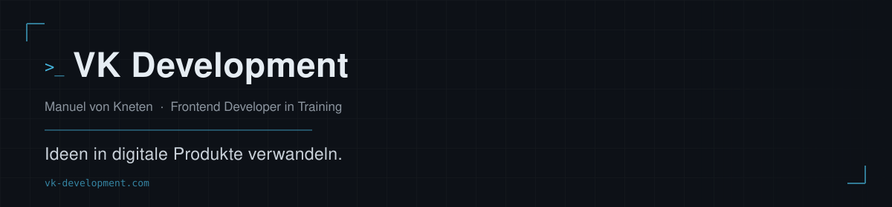

  

 

Ich bin Manuel, Frontend-Entwickler in Ausbildung bei der Developer Akademie und Gründer von **VK Development**. Ich baue saubere, responsive Web-Anwendungen mit Vanilla JavaScript und objektorientierter Architektur — und erweitere meinen Stack gerade gezielt Richtung TypeScript, Angular und Backend/Linux, um ganze Produkte statt nur Oberflächen liefern zu können.

 

### 🔧 Stack

|  | Technologien |
|---|---|
| **Im Einsatz** | HTML5 · CSS3 · JavaScript (ES6+) · Responsive Design · Firebase (REST) |
| **Aktuell in Vertiefung** | TypeScript · Angular · Python · Django · Linux-Serveradministration · Backend-Entwicklung |

 

### 📌 Ausgewählte Projekte

**[Join](https://github.com/ManuelvonKneten/Join)** — Kanban-Board mit Drag & Drop, Firebase-Realtime-DB-Anbindung über REST, Task- und Kontaktverwaltung, Subtasks und Authentifizierung inkl. Gastmodus.
Stack: HTML · CSS · JavaScript · Firebase
*Teamprojekt (3 Entwickler) im Rahmen der Developer Akademie.*

**[PokeDex](https://github.com/ManuelvonKneten/PokeDex)** — Interaktive Pokédex-Anwendung mit Anbindung an die PokéAPI, Live-Suche, Pagination per Load-more und Dark-Mode-Toggle.
Stack: HTML · CSS · JavaScript · PokéAPI

**[BestellApp](https://github.com/ManuelvonKneten/BestellApp)** — Lernprojekt zur Übung der Web-Grundlagen: Produktkatalog, Warenkorb und automatische Summenberechnung.
Stack: HTML · CSS · JavaScript

**[El_Pollo_Loco](https://github.com/ManuelvonKneten/El_Pollo_Loco)** — 2D-Jump-and-Run im Browser auf Basis der HTML5-Canvas-API, objektorientiert in reinem Vanilla JavaScript umgesetzt, installierbar als PWA.
Stack: JavaScript (ES6-Klassen) · Canvas API
🎮 [Live spielen](https://pollo.manuel-von-kneten.de/)

 

### 📊 GitHub-Aktivität

  
  

 

### 📬 Kontakt

🌐 [vk-development.com](https://vk-development.com) · ✉️ [info@vk-development.com](mailto:info@vk-development.com)

